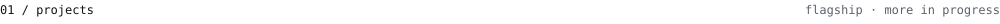
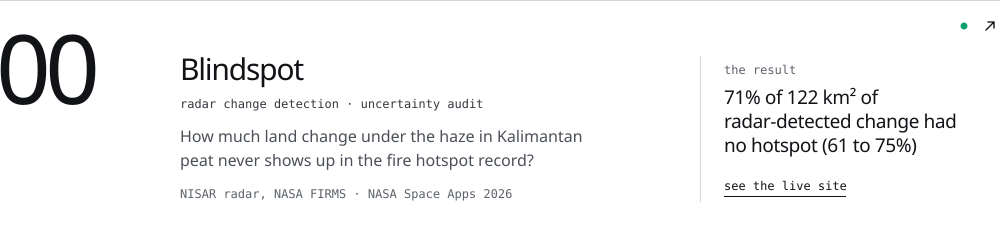
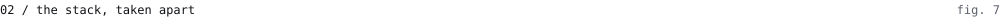

<!-- Artwork is generated by scripts/build.py. Edit the CONTENT block there, then run: python3 scripts/build.py -->
<!-- Projects 01 to 06 are built (assets/project-01..06) but hidden until each has real results; add its row back under Blindspot. -->

<picture><source media="(prefers-color-scheme: dark)" srcset="assets/header-dark.svg"></picture>

<picture><source media="(prefers-color-scheme: dark)" srcset="assets/hero-dark.svg"></picture>

 

<picture><source media="(prefers-color-scheme: dark)" srcset="assets/label-work-dark.svg"></picture>

  <a href="https://blindspotsg.earth"><picture><source media="(prefers-color-scheme: dark)" srcset="assets/project-00-dark.svg"></picture></a> 

 

<picture><source media="(prefers-color-scheme: dark)" srcset="assets/label-stack-dark.svg"></picture>

<picture><source media="(prefers-color-scheme: dark)" srcset="assets/stack-dark.svg"></picture>

 

<a href="mailto:abdallahdiaa06@gmail.com"><picture><source media="(prefers-color-scheme: dark)" srcset="assets/hello-dark.svg"></picture></a>

  <a href="mailto:abdallahdiaa06@gmail.com"><code>email</code></a>&nbsp;&nbsp;·&nbsp;&nbsp;<a href="https://www.linkedin.com/in/abdallahdiaa/"><code>linkedin</code></a>

